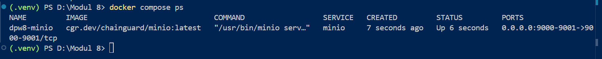
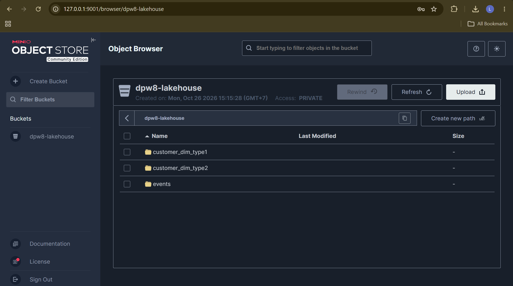
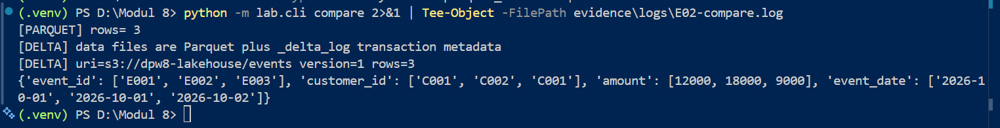
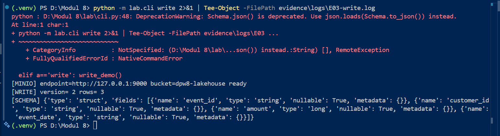
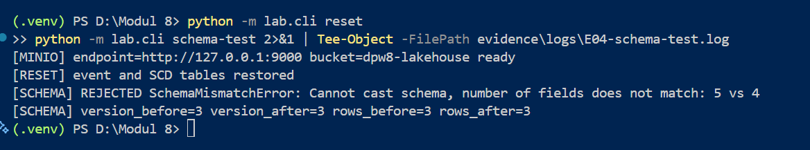
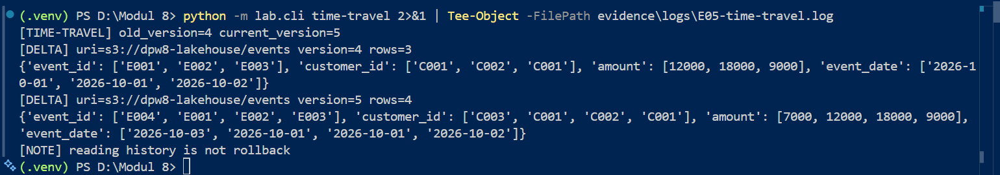
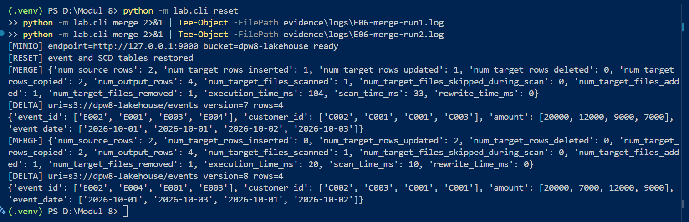
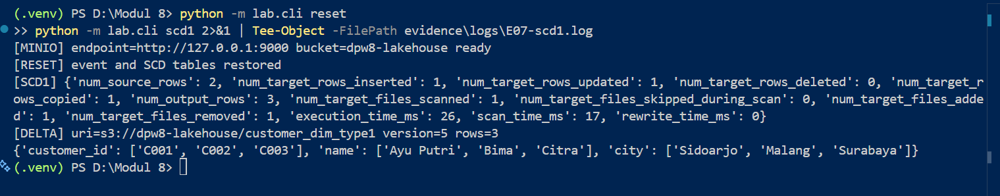
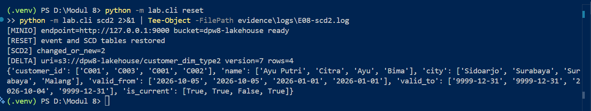
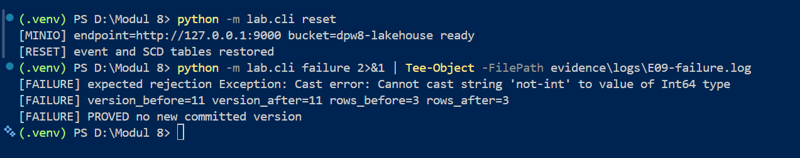

# Evidence Chain — DPW Modul 8
Untuk setiap aktivitas lampirkan log, screenshot, potongan kode/config, output sebelum-sesudah, dan analisis singkat.

## E01 Environment/MinIO
**Perintah:** `docker compose up -d`, `docker compose ps`, `python -m lab.cli init`, `python -m lab.cli reset`
**Screenshot:** 
- 
- 
**Analisis:** Container `dpw8-minio` berhasil berjalan dan statusnya `Up`. Perintah `init` dan `reset` berhasil membuat bucket `dpw8-lakehouse` serta menyiapkan struktur tabel Delta yang dibuktikan dengan terlihatnya folder `events`, `customer_dim_type1`, dan `customer_dim_type2` pada MinIO Console.

## E02 Parquet vs Delta
**Perintah:** `python -m lab.cli compare`
**Screenshot:** 
- 
- 
**Output:**
- [PARQUET] rows= 3
- [DELTA] data files are Parquet plus _delta_log transaction metadata
**Analisis:** File Parquet baseline hanya berisi data murni. Sedangkan tabel Delta Lake pada folder `events` tidak hanya berisi file Parquet, tetapi juga memiliki folder `_delta_log`. Folder log inilah yang menyimpan metadata transaksi (ACID), skema, dan histori versi yang tidak dimiliki oleh Parquet mandiri.

## E03 Write/schema/row count/version
**Perintah:** `python -m lab.cli write`
**Screenshot:** 
**Output:**
- `[WRITE] version= 2 rows= 3`
- `[SCHEMA] {'type': 'struct', 'fields': [{'name': 'event_id'...`
**Analisis:** Penulisan (write) data berhasil dilakukan. Delta Lake mencatat perubahan ini dengan menaikkan versi tabel menjadi versi 2. Jumlah baris yang ditulis adalah 3 baris, dan schema berhasil terbaca dengan tipe data yang sesuai (`event_id` string, `amount` long, dll).

## E04 Schema enforcement: error, version dan row count sebelum-sesudah
**Perintah:** `python -m lab.cli reset` dilanjutkan `python -m lab.cli schema-test`
**Screenshot:** 
**Output:**
- `[SCHEMA] REJECTED SchemaMismatchError: Cannot cast schema, number of fields does not match: 5 vs 4`
- `[SCHEMA] version_before=3 version_after=3 rows_before=3 rows_after=3`
**Analisis:** Delta Lake berhasil menolak input yang mencoba menambahkan kolom baru (`unexpected_column`) yang tidak sesuai dengan kontrak schema awal. Karena write ditolak, tidak ada commit baru yang tercatat di `_delta_log`, dibuktikan dengan angka `version` dan `rows` yang tidak berubah sebelum dan sesudah eksekusi.

## E05 Time travel: versi awal vs current; jelaskan bukan rollback
**Perintah:** `python -m lab.cli time-travel`
**Screenshot:** 
**Output:**
- Versi lama (`version=4`): rows=3
- Versi current (`version=5`): rows=4
- `[NOTE] reading history is not rollback`
**Analisis:** Fitur time travel memungkinkan pembacaan snapshot data di masa lalu (versi 4 dengan 3 baris). Ini bukanlah operasi *rollback*, karena versi current (versi 5 dengan 4 baris) tetap utuh dan tidak terhapus. Time travel hanya bersifat *read-only* terhadap histori.

## E06 Merge: metrics dan output
**Perintah:** `python -m lab.cli reset`, `python -m lab.cli merge` (dijalankan 2x)
**Screenshot:** 
**Output Run 1:** inserted=1, updated=1, num_output_rows=4
**Output Run 2:** inserted=0, updated=2, num_output_rows=4
**Analisis:** Operasi MERGE berhasil memperbarui data E002 (amount menjadi 20000) dan menambahkan E004. Saat dijalankan kedua kali (uji idempotensi), tidak ada duplikasi data (inserted=0). Hal ini membuktikan MERGE menggunakan *merge key* (`event_id`) untuk menentukan apakah data harus di-update atau di-insert.

## E07 SCD Type 1: output dimensi setelah update
**Perintah:** `python -m lab.cli reset`, `python -m lab.cli scd1`
**Screenshot:** 
**Output:** C001 menjadi `Ayu Putri`/`Sidoarjo`, dan C003 (`Citra`) ditambahkan. Total 3 baris.
**Analisis:** SCD Type 1 bekerja dengan cara menimpa (*overwrite*) data lama. Atribut C001 yang lama (Ayu/Surabaya) hilang dan digantikan dengan data baru. Tidak ada riwayat versi lama yang disimpan, sehingga jumlah baris tetap 3.

## E08 SCD Type 2: versi lama/current, valid_from/valid_to/is_current
**Perintah:** `python -m lab.cli reset`, `python -m lab.cli scd2`
**Screenshot:** 
**Output:** C001 memiliki 2 baris (versi lama dan baru). Total 4 baris.
**Analisis:** Berbeda dengan SCD1, SCD2 menyimpan riwayat perubahan. C001 memiliki versi lama dengan `valid_to=2026-10-04` dan `is_current=false`, serta versi baru dengan `valid_from=2026-10-05` dan `is_current=true`. C003 ditambahkan sebagai data current. Total baris bertambah menjadi 4 untuk menjaga histori.

## E09 Failure injection: state sebelum-sesudah dan kesimpulan
**Perintah:** `python -m lab.cli reset`, `python -m lab.cli failure`
**Screenshot:** 
**Output:**
- `[FAILURE] expected rejection Exception: Cast error...`
- `[FAILURE] version_before=11 version_after=11 rows_before=3 rows_after=3`
- `[FAILURE] PROVED no new committed version`
**Analisis:** Failure injection membuktikan bahwa Delta Lake menolak penulisan data dengan tipe yang salah (string `'not-int'` dimasukkan ke kolom `amount` yang bertipe Int64). State tabel tidak berubah (version dan rows sama). **Yang dibuktikan:** Delta Lake memvalidasi tipe data dan mencegah korupsi data. **Yang tidak dibuktikan:** Skenario konkurensi multi-writer (banyak penulis bersamaan).

---

## Jawaban Checkpoint
1. **Apa fungsi `_delta_log` yang tidak dimiliki file Parquet mandiri?**
   `_delta_log` berfungsi sebagai transaction log yang menyimpan metadata, schema, dan histori commit. Ini memungkinkan fitur ACID, time travel, dan schema enforcement yang tidak bisa dilakukan oleh file Parquet mandiri.

2. **Bagaimana membuktikan schema violation tidak membuat commit baru?**
   Dengan membandingkan nilai `version` dan `rows` sebelum dan sesudah eksekusi. Jika nilainya sama persis, berarti tidak ada transaksi/commit baru yang tercatat.

3. **Apa beda time travel read dan rollback?**
   Time travel read hanya membaca snapshot data lama tanpa mengubah state tabel saat ini (read-only). Rollback adalah tindakan menulis state baru untuk mengembalikan tabel ke kondisi sebelumnya (mengubah state current).

4. **Bagaimana MERGE menentukan update atau insert?**
   Berdasarkan *merge key* (dalam praktikum ini adalah `event_id`). Jika key cocok dengan data di target, maka di-update. Jika tidak ada, maka di-insert.

5. **Apa bukti perbedaan SCD1 dan SCD2 pada tabel?**
   SCD1: Hanya ada 1 baris per key (data lama tertimpa). SCD2: Ada 2 baris untuk key yang berubah (C001), dilengkapi dengan kolom `valid_from`, `valid_to`, dan `is_current` untuk melacak histori.

6. **Apa yang dibuktikan dan tidak dibuktikan oleh failure injection?**
   **Dibuktikan:** Delta Lake berhasil menolak tipe data yang salah dan tidak membuat commit baru. **Tidak dibuktikan:** Kemampuan Delta Lake menangani konkurensi multi-writer (banyak proses menulis secara bersamaan).